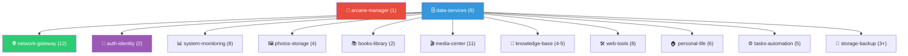

# 🏠 Rapport d'Infrastructure Homelab — Carte Long Terme v2

> **Domaine** : `boul2gom.com` | **Serveur** : HP EliteDesk G4 800 | **Stockage** : SSD interne + 2×4TB USB (RAID miroir)
> **OS conteneurs** : `/srv/containers/` | **Données** : `/srv/data/`
> **User** : PUID=1000 PGID=1000 | **TZ** : Europe/Paris


## Grimmory + Kobo — Comment ça marche

1. Tu configures Grimmory comme serveur de sync Kobo
2. Tu modifies `Kobo eReader.conf` sur ta liseuse (via USB) pour pointer `api_endpoint` vers `https://books.boul2gom.com`
3. Quand la Kobo se connecte au Wi-Fi, elle interroge Grimmory au lieu du Kobo Store
4. Les livres ajoutés à ta bibliothèque Grimmory sont **automatiquement téléchargés** sur la Kobo
5. La progression de lecture est synchronisée entre Grimmory et ta Kobo

> [!NOTE]
> Tu gardes Calibre (desktop VNC) pour l'import et l'édition des métadonnées. Grimmory lit la même bibliothèque Calibre.

---

## Gluetun + PIA

PIA est [nativement supporté par Gluetun](https://github.com/qdm12/gluetun-wiki/blob/main/setup/providers/private-internet-access.md). Configuration :

```yaml
gluetun:
  image: qmcgaw/gluetun:latest
  container_name: gluetun
  cap_add:
    - NET_ADMIN
  environment:
    VPN_SERVICE_PROVIDER: private internet access
    OPENVPN_USER: ${PIA_USERNAME}
    OPENVPN_PASSWORD: ${PIA_PASSWORD}
    SERVER_REGIONS: France
```

qBittorrent route son trafic via `network_mode: "service:gluetun"` — tout son trafic passe par le tunnel PIA.

---

## Architecture des projets — 13 projets, ~65 conteneurs



---

## Détail de chaque projet

---

### 🎉 1. `arcane-manager` — 1 conteneur

| Service | Image | DB | Auth | Subdomains proposés |
|---------|-------|-----|------|---------------------|
| 🎉 Arcane | `ghcr.io/getarcaneapp/manager:latest` | SQLite intégré | OIDC natif | `arcane` · `manager` · `deploy` |

---

### 2. `data-services` — 6 conteneurs

| Service | Image | Rôle | Subdomains proposés |
|---------|-------|------|---------------------|
| 🎉 PostgreSQL | `postgres:18-alpine` | BDD relationnelle | *(interne)* |
| 🎉 Valkey | `valkey/valkey:alpine` | Cache/pub-sub | *(interne)* |
| 🎉 Garage | `dxflrs/garage:v2` | Object storage S3 | `assets` |
| 🎉 RabbitMQ | `rabbitmq:alpine` | Message broker | *(interne)* |
| 🎉 InfluxDB | `influxdb:2-alpine` | Time-series | `influx` · `tsdb` · `metrics` |
| 🎉 Meilisearch | `getmeili/meilisearch:latest` | *(fichiers)* | API key | *(interne)* |
| 🎉 DbGate | `dbgate/dbgate:alpine` | GUI BDD | `data` · `dbui` · `database` |
| MapTiler Server | `maptiler/server:latest` | Serveur cartographique | `maps` · `tiles` |

---

### 3. `network-gateway` — 12 conteneurs

| Service | Image | Auth | Subdomains proposés |
|---------|-------|------|---------------------|
| 🎉 GoDoxy | `ghcr.io/yusing/godoxy:latest` | OIDC natif | `proxy` · `gateway` · `gw` |
| 🎉 Cloudflare-DDNS | `timothyjmiller/cloudflare-ddns:latest` | *(aucune)* | *(aucun)* |
| 🎉 Blocky | `ghcr.io/0xerr0r/blocky:latest` | *(réseau local)* | `dns` · `adblock` · `blocky` |
| 🎉 Blocky UI | `ghcr.io/gabeduartem/blocky-ui:latest` | Middleware OIDC | *(interne au dashboard)* |
| CrowdSec | `crowdsecurity/crowdsec:latest` | *(aucune)* | *(interne)* |
| Glance | `glanceapp/glance:latest` | Middleware OIDC GoDoxy | `home` · `dash` · `apps` |
| 🎉 NetBird Dashboard | `netbirdio/dashboard:latest` | OIDC natif | `vpn` · `mesh` · `netbird` |
| 🎉 NetBird Management| `netbirdio/management:latest` | OIDC natif | `mesh` (API) |
| 🎉 NetBird Signal | `netbirdio/signal:latest` | *(aucune)* | `negotiate` |
| 🎉 NetBird Relay | `netbirdio/relay:latest` | *(aucune)* | `relay` |
| 🎉 NetBird Coturn | `coturn/coturn:latest` | *(aucune)* | `turn` (UDP) |
| 🎉 NetBird Client | `netbirdio/netbird:latest` | Setup Key | *(aucun, network_mode: host)* |

---

### 4. `auth-identity` — 2 conteneurs

| Service | Image | DB | Auth | Subdomains proposés |
|---------|-------|-----|------|---------------------|
| 🎉 Pocket-ID | `ghcr.io/pocket-id/pocket-id:latest` | PostgreSQL partagé | Passkeys natif | `auth` · `id` · `login` |
| Logto | `ghcr.io/logto-io/logto:latest` | PostgreSQL partagé | OIDC natif | `sso` · `oauth` · `accounts` |

---

### 5. `system-monitoring` — 8 conteneurs

| Service | Image | DB | Auth | Subdomains proposés |
|---------|-------|-----|------|---------------------|
| 🎉 Kener | `rajnandan1/kener:latest-alpine` | PostgreSQL + Valkey | Auth interne | `status` · `uptime` · `health` |
| 🎉 Scrutiny Web | `ghcr.io/analogj/scrutiny:latest-web` | SQLite intégré | Middleware OIDC | `scrutiny` · `disks` · `drives` |
| 🎉 Scrutiny Collector | `ghcr.io/analogj/scrutiny:latest-collector` | *(aucune)* | *(aucune)* | *(interne)* |
| 🎉 Dozzle | `amir20/dozzle:latest` | *(aucune)* | Auth interne | `logs` · `dozzle` · `containers` |
| Beszel Hub | `henrygd/beszel:latest` | SQLite intégré | Auth interne | `monitor` · `beszel` · `server` |
| Beszel Agent | `henrygd/beszel-agent:latest` | *(aucune)* | *(aucune)* | *(interne)* |
| GlitchTip | `glitchtip/glitchtip:latest` | PostgreSQL partagé | OIDC natif | `errors` · `sentry` · `bugs` |
| Umami | `ghcr.io/umami-software/umami:postgresql-latest` | PostgreSQL partagé | Auth interne | `analytics` · `stats` · `visits` |

---

### 🎉 6. `photo-storage` — 4 conteneurs

| Service | Image | DB | Auth | Subdomains proposés |
|---------|-------|-----|------|---------------------|
| 🎉 Immich Server | `ghcr.io/immich-app/immich-server:release` | Immich Postgres dédié | OIDC natif | `photos` · `gallery` · `pictures` |
| 🎉 Immich ML | `ghcr.io/immich-app/immich-machine-learning:release-openvino` | *(aucune)* | *(interne)* | *(interne)* |
| 🎉 Immich Postgres | `ghcr.io/immich-app/postgres:18-vectorchord1.1.1` | *(self)* | *(interne)* | *(interne)* |
| 🎉 Immich Atlas | `ghcr.io/guimartins/immich-atlas:latest` | *(aucune)* | Middleware OIDC | `photos-stats` · `atlas` · `photos-analytics` |

---

### 7. `book-library` — 2 conteneurs

| Service | Image | DB | Auth | Subdomains proposés |
|---------|-------|-----|------|---------------------|
| 🎉 Calibre | `lscr.io/linuxserver/calibre:latest` | *(fichiers)* | Auth interne VNC | `calibre` · `books-admin` · `library-admin` |
| Grimmory | `ghcr.io/grimmory-tools/grimmory:latest` | SQLite/PostgreSQL | OIDC natif | `books` · `library` · `read` |

---

### 8. `media-center` — 11 conteneurs

| Service | Image | DB | Auth | Subdomains proposés |
|---------|-------|-----|------|---------------------|
| Jellyfin | `jellyfin/jellyfin:latest` | SQLite intégré | Auth interne | `media` · `watch` · `stream` |
| Jellyseerr | `fallenbagel/jellyseerr:latest` | SQLite intégré | Auth interne (Jellyfin) | `requests` · `discover` · `movies` |
| Sonarr | `lscr.io/linuxserver/sonarr:latest` | SQLite intégré | Middleware OIDC | `sonarr` · `tv` · `series` |
| Radarr | `lscr.io/linuxserver/radarr:latest` | SQLite intégré | Middleware OIDC | `radarr` · `films` · `cinema` |
| Prowlarr | `lscr.io/linuxserver/prowlarr:latest` | SQLite intégré | Middleware OIDC | `prowlarr` · `indexers` · `search` |
| Bazarr | `lscr.io/linuxserver/bazarr:latest` | SQLite intégré | Middleware OIDC | `bazarr` · `subtitles` · `subs` |
| Lidarr | `lscr.io/linuxserver/lidarr:latest` | SQLite intégré | Middleware OIDC | `lidarr` · `music-dl` · `albums` |
| qBittorrent | `lscr.io/linuxserver/qbittorrent:latest` | *(aucune)* | Auth interne | `torrent` · `qbit` · `downloads` |
| Gluetun | `qmcgaw/gluetun:latest` | *(aucune)* | *(aucune)* | *(interne — VPN PIA)* |
| Cobalt | `ghcr.io/imputnet/cobalt:latest` | *(aucune)* | Middleware OIDC | `dl` · `ytdl` · `cobalt` |
| Recyclarr | `ghcr.io/recyclarr/recyclarr:latest` | *(aucune)* | *(aucune — CLI cron)* | *(interne — pas de web UI)* |

> [!NOTE]
> **Recyclarr** est un CLI qui tourne en cron (pas de web UI). Il sync automatiquement les profils qualité TRaSH Guides vers Sonarr/Radarr.
> **Gluetun** utilise PIA. qBittorrent est attaché via `network_mode: "service:gluetun"`.

---

### 9. `knowledge-base` — 4 conteneurs

| Service | Image | DB | Auth | Subdomains proposés |
|---------|-------|-----|------|---------------------|
| 🎉 Wiki | `Outline` | PostgreSQL + S3 | OIDC natif | `wiki` · `docs` · `notes` |
| Plane | `makeplane/plane-*` | PostgreSQL + Valkey + MinIO interne | OIDC natif | `projects` · `plan` · `tasks` |
| 🎉 Memos | `neosmemo/memos:stable` | SQLite/PostgreSQL | OIDC natif | `memo` · `jot` · `quick` |
| Khoj | `ghcr.io/khoj-ai/khoj:latest` | PostgreSQL partagé | Auth interne | `khoj` · `ai` · `rag` |

---

### 10. `web-tools` — 8 conteneurs

| Service | Image | DB | Auth | Subdomains proposés |
|---------|-------|-----|------|---------------------|
| 🎉 Stirling-PDF | `stirlingtools/stirling-pdf:latest-fat` | PostgreSQL partagé | Auth interne | `pdf` · `tools` · `docs-tools` |
| Mazanoke | `ghcr.io/civilblur/mazanoke:latest` | *(client-side)* | Middleware OIDC | `img` · `compress` · `images` |
| Draw.io | `jgraph/drawio:latest` | *(client-side)* | Middleware OIDC | `draw` · `diagrams` · `drawio` |
| Excalidraw | `excalidraw/excalidraw:latest` | *(client-side)* | Middleware OIDC | `sketch` · `whiteboard` · `canvas` |
| Reactive Resume | `amruthpillai/reactive-resume:latest` | PostgreSQL partagé | Auth interne | `cv` · `resume` · `career` |
| DrawDB | `ghcr.io/drawdb-io/drawdb:latest` | *(client-side)* | Middleware OIDC | `erd` · `schema` · `dbdesign` |
| Tolgee | `tolgee/tolgee:latest` | PostgreSQL partagé | OIDC natif | `i18n` · `translate` · `lang` |
| Rackula | `ghcr.io/rackulalives/rackula:latest` | *(fichiers)* | Auth interne | `rack` · `infra` · `hardware` |

---

### 11. `personal-life` — 6 conteneurs

| Service | Image | DB | Auth | Subdomains proposés |
|---------|-------|-----|------|---------------------|
| Homebox | `ghcr.io/sysadminsmedia/homebox:latest` | SQLite intégré | Auth interne | `inventory` · `stuff` · `home-inv` |
| MonicaHQ | `monica:latest` | MySQL/MariaDB | Auth interne | `contacts` · `crm` · `people` |
| Baikal | `ckulka/baikal:latest` | SQLite intégré | Auth interne | `dav` · `calendar` · `caldav` |
| Gramps Web | `ghcr.io/gramps-project/grampsweb:latest` | SQLite intégré | Auth interne | `family` · `genealogy` · `tree` |
| Securo | `ghcr.io/securo-finance/securo-backend:latest` | PostgreSQL partagé | OIDC natif | `finance` · `budget` · `money` |
| 🎉 TREK | `mauriceboe/trek:latest` | PostgreSQL partagé | OIDC natif | `travel` · `trips` · `voyages` |
| SolidTime | `solidtime/solidtime:latest` | PostgreSQL partagé | OIDC natif | `time` · `clock` · `timetrack` |

> [!WARNING]
> **MonicaHQ** nécessite MySQL/MariaDB. Il faudra ajouter un conteneur MariaDB dédié dans ce projet (~7 conteneurs total), ou évaluer si **Twenty CRM** (PostgreSQL natif, UI moderne) serait un meilleur choix.

---

### 12. `task-automation` — 5 conteneurs

| Service | Image | DB | Auth | Subdomains proposés |
|---------|-------|-----|------|---------------------|
| Activepieces | `activepieces/activepieces:latest` | PostgreSQL + Valkey | OIDC natif | `auto` · `flows` · `automate` |
| OliveTin | `ghcr.io/olivetin/olivetin:latest` | *(aucune)* | Auth interne | `run` · `commands` · `actions` |
| Cronicle | `soulteary/cronicle:latest` | *(fichiers)* | Auth interne | `cron` · `scheduler` · `jobs` |
| Ntfy | `binwiederhier/ntfy:latest` | SQLite intégré | Auth interne | `notify` · `push` · `alerts` |
| Atuin | `ghcr.io/atuinsh/atuin:latest` | PostgreSQL partagé | Auth interne (E2EE) | *(interne)* |

---

### 13. `storage-backup` — 3+ conteneurs

| Service | Image | DB | Auth | Subdomains proposés |
|---------|-------|-----|------|---------------------|
| Backrest | `garethgeorge/backrest:latest` | *(fichiers)* | Auth interne | `backup` · `backups` · `restic` |
| Seafile | `seafileltd/seafile-mc:latest` | MariaDB dédié + Memcached | Auth interne | `files` · `cloud` · `drive` |
| 🎉 iCloud Drive | `mandarons/icloud-drive:latest` | *(aucune)* | Apple iCloud | *(aucun)* |

---

## URL et routing

- **Chaque service** = un subdomain `xxx.boul2gom.com`
- **Dashboard** = `home.boul2gom.com` (Glance)
- **Pas de path-based routing** (problèmes de compatibilité)
- **Page publique** : `status.boul2gom.com` (Kener, sans auth)

---

### Choix restants

| Question | Options |
|----------|---------|
| Dashboard | Glance (minimaliste YAML) · Homarr (GUI widgets) |
| Scanopy (futur) | Ajouter à network-gateway quand prêt |
